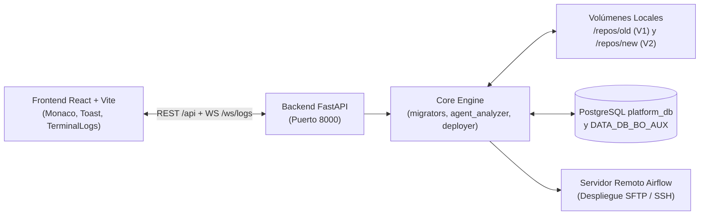

# 🚀 DATAX Migration Studio V2

Plataforma local en Docker para migrar, estandarizar, probar y desplegar robots de datos **V1 ➔ V2** sobre el ecosistema **DATAX** (Descarga, Conversión, Migración a PostgreSQL, AutoGenerate IA y Métricas).

---

## 🧭 Resumen de Arquitectura



> [!info] Modelo de Trabajo Local (Recomendado)
> Cada desarrollador ejecuta el Studio en su propia computadora mediante Docker apuntando a sus clones locales de **V1** y **V2**. Así cada uno valida sus archivos `.py`, `.sql` y `.sqlite` en su editor y Git sin conflictos con el resto del equipo, y despliega al servidor remoto solo cuando los tests aprueban.

---

## 📋 Prerrequisitos

- [x] **Docker Desktop** instalado y en ejecución.
- [x] **Git** instalado.
- [x] Clones locales de:
  - Repositorio **V1** (fábrica antigua).
  - Repositorio **V2** (fábrica nueva / `data-processing-modules`).
- [x] Acceso de red/VPN al servidor de base de datos y Airflow (`10.0.0.16`).

---

## ⚙️ Instalación y Primer Arranque

### 1. Clonar y crear `.env`
```powershell
git clone <URL_DEL_REPOSITORIO>
cd Datax-Migration-Tool
Copy-Item .env.example .env
```

### 2. Configurar `.env`
Editar `.env` con las rutas absolutas de tu equipo y las credenciales del entorno:

```env
# Rutas locales en tu PC
OLD_REPO_PATH=E:\DATAX\data-processing-platform\
NEW_REPO_PATH=E:\DATAX\data-processing-platform-dev\
APP_PORT=8000

# Servidor remoto (SSH / SFTP / Airflow)
SSH_HOST=10.0.0.16
SSH_PORT=22
SSH_USER=datax-pds
SSH_PASS=<password>

# PostgreSQL (platform_db)
DB_HOST=10.0.0.16
DB_PORT=5434
DB_USER=postgres
DB_PASS=datax
DB_NAME=platform_db

# GitHub, Gemini IA y Taiga
GITHUB_REPO=datax-platform/data-processing-modules
GITHUB_TOKEN=<github_pat>
GEMINI_API_KEY=<gemini_api_key>
TAIGA_HOST=https://investigaciontaiga.datax.com.bo
TAIGA_USER=<usuario>
TAIGA_PASS=<password>
TAIGA_PROJECT_SLUG=procesamiento-de-archivos-2
```

> [!warning] Regla de Seguridad
> El archivo `.env` está en `.gitignore`. **Nunca** lo subas al repositorio.

### 3. Levantar el contenedor
* **Primera vez (o cuando cambie `requirements.txt` / `Dockerfile`):**
  ```powershell
  docker compose up -d --build
  ```
* **Uso diario (arranque rápido):**
  ```powershell
  docker compose up -d
  ```
* **Abrir en el navegador:** `http://localhost:8000`
* **Documentación API (Swagger):** `http://localhost:8000/docs`

---

## 🧩 Módulos de la Plataforma

### 1. 📥 Robots de Descarga (`D_...`)
- **Modos:** *Migrar desde V1 (Legado)* o *Código V2 Existente / Nuevo*.
- **Tipos soportados:**
  - **Tipo I:** `get_file_url()` + `compare_files()` (`test_download_type_i.py`)
  - **Tipo II:** `verify_download()` + `compare_files()` (`test_download_type_ii.py`)
  - **Tipo III:** `check_new_data()` (`test_download_type_iii.py`)
  - **Tipo IV:** `get_data()` con prefijo `YYYY-MM-DD_` (`test_download_type_iv.py`)
- **Funciones clave:**
  - Editor Monaco integrado con guardado directo en V2.
  - Ejecución de pruebas unitarias con fecha de prueba configurable (`updated_to`).
  - Actualización rápida de `updated_to` en `platform_db` y generación de DAG.
  - Despliegue al servidor vía SFTP y disparo remoto en Airflow.

> [!tip] Evitar timeouts en reportes diarios
> Si un robot diario (ej. CNDC) acumula muchos días desde la última fecha en BD, en la pestaña de pruebas usa una fecha de prueba reciente (ej. de hace 3–5 días) para validar el scraper en pocos segundos sin superar el límite de 240s.

---

### 2. 🔄 Robots de Conversión (`C_...`)
Flujo guiado en **5 pasos**:
1. **Selección y Código:** Explora familias `C_BO_...` o importa desde GitHub PR / archivo local / editor.
2. **Pruebas Unitarias (`test_conversion.py`):**
   - Subida de archivos de muestra (Excel/PDF).
   - Prueba de **Extracción Pura** (sin `text_match`).
   - Prueba **Con Reemplazos** (`text_match` hacia `DATA_DB_BO_AUX`).
3. **Verificación SQL (SQLite y Reemplazos):**
   - Inspección de la tabla generada en `.sqlite` (`data_melted` o código del reporte).
   - Editor interactivo de reemplazos sobre `DATA_DB_BO_AUX` (alta, edición, búsqueda y eliminación con confirmación).
4. **Plantilla (`columns_to_review`) & DAG:** Configuración de niveles jerárquicos (`nv1..nvN`) y generación de DAG de conversión.
5. **Despliegue:** Subida al servidor remoto por SFTP y disparo de DAG en Airflow.

---

### 3. 🚚 Robots de Migración (`M_... / PostgreSQL`)
1. **Selección por Familia y Reporte:** Carga automáticamente el `.sqlite` exacto del reporte seleccionado.
2. **Agente Analizador Inteligente (Gemini + Heurístico):**
   - Inspecciona títulos, jerarquías (`nv1..nvN`) y estadísticas de `valor`.
   - Clasifica reportes homogéneos o mixtos (`is_mixed`), determinando `metrica` (`moneda`, `precio`, `tasa`, `tipo_cambio`, `porcentaje`, `indice`, etc.), `unidad_metrica` (`BOB`, `USD`, `UFV`, `%`, `USD/Oz`, `GBP/Tn`, etc.) y `conversion_factor`.
3. **Vista Previa de Datos Simulada (PostgreSQL):**
   - Muestra en tiempo real las columnas simuladas `metrica_preview` y `unidad_preview` antes de generar código, tanto tras el análisis IA como al ajustar parámetros manualmente.
4. **Previsualización y Despliegue:** Genera el script DDL `.sql` (`CREATE TABLE`) y el orquestador `.py` (`M_...py`), permite guardar en V2 y desplegar al servidor.

---

### 4. 🤖 AutoGenerate (IA + Taiga) y 📊 Métricas
- **AutoGenerate:** Conecta con Taiga Kanban para leer User Stories, descargar adjuntos de muestra y generar robots con asistencia de IA bajo los estándares DATAX.
- **Métricas:** Consulta el avance histórico de robots (descarga, conversión, migración y pipeline completo) con filtros por fecha y exportación a CSV / JSON.

---

## 🔧 Comandos Docker de Mantenimiento

| Acción | Comando |
| :--- | :--- |
| Iniciar en segundo plano | `docker compose up -d` |
| Reconstruir tras cambios en `requirements.txt` o `Dockerfile` | `docker compose up -d --build` |
| Reiniciar backend tras editar `core/` o `server/` | `docker compose restart` |
| Ver logs en vivo | `docker compose logs -f` |
| Entrar a la consola del contenedor | `docker exec -it datax-migration-studio bash` |
| Detener y eliminar contenedor | `docker compose down` |

---

## 🩺 Troubleshooting Rápido

- **Cambió `.env` pero el contenedor sigue viendo rutas viejas:**
  Ejecuta `docker compose up -d` para recrear el contenedor con los nuevos volúmenes.
- **`ModuleNotFoundError` en pruebas unitarias:**
  Falta reconstruir la imagen para instalar librerías nuevas: `docker compose up -d --build`.
- **Error de conexión a PostgreSQL (`10.0.0.16:5434`):**
  Verifica VPN/red corporativa y prueba la conexión desde **Configuración .env → Probar DB**.
- **Cambios en frontend no se reflejan:**
  Si trabajas con Docker, ejecuta `docker compose up -d --build` para recompilar el bundle de React y recarga el navegador con `Ctrl + F5`.

